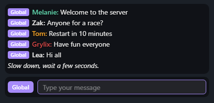

# HappinessMP Chatbox

A chat for [HappinessMP](https://happinessmp.net).
Press T or Y to write, Enter to send, Escape to close. Names are coloured by rank.



*[Version française plus bas](#français)*

## Install

1. Copy the `chat` folder into your server's `resources` folder.
2. In `settings.xml`, add `<resource>chat</resource>` and turn the built-in chat off with `<chat>false</chat>` ([docs](https://happinessmp.net/docs/server/settings/)).
3. Restart the server.

If the built-in chat stays on, players get two chats.

## Settings

Everything is in `chat/config.lua`:

- `Language`: `"en"` or `"fr"`.
- `Position`: `"top-left"`, `"top-right"`, `"bottom-left"` or `"bottom-right"`.
- `OffsetX` / `OffsetY`: distance from that corner, in % of the screen.
- `Width` / `Lines`: size of the chat.
- `FadeDelay`: seconds before old messages fade when the chat is closed.
- `OpenKeys`: the keys that open the chat (T and Y by default).
- `MaxLength`: max characters per message.
- `Flood` / `BlockRepeat`: anti-spam.
- `Ranks`: name colour of each rank.
- `Staff`: gives a rank by player name.

Press Up and Down in the input to bring back your last messages.

## From your other scripts

Server:

```lua
Exports.chat:SendMessage(playerId, "{FFFFFF}Hello")  -- one player
Exports.chat:BroadcastMessage("{FF0000}Restart soon") -- everyone
Exports.chat:SetPlayerRank(playerId, "admin")         -- a rank from config.lua
```

Client:

```lua
Exports.chat:AddMessage("Only you see this")

-- Hide the chat and block it (during a menu, a game mode...)
Events.Call("chatbox:setLocked", { "my_menu", true })
-- Give it back
Events.Call("chatbox:setLocked", { "my_menu", false })

-- Change the language
Events.Call("chatbox:setLanguage", { "fr" })

-- Know when the input opens or closes
Events.Subscribe("chatbox:visibilityChanged", function(open) end)
```

Colours work inside messages: `{RRGGBB}`. Anything starting with `/` is sent to your scripts with the `chatCommand` event.

The chat locks itself when the player is dead, in the pause menu, or when another WebUI page has focus.

## License

MIT, see [LICENSE](LICENSE).

---

## Français

Un chat pour [HappinessMP](https://happinessmp.net).
Appuie sur T ou Y pour écrire, Entrée pour envoyer, Échap pour fermer. Les pseudos sont colorés selon le rang.

### Installation

1. Copie le dossier `chat` dans le dossier `resources` de ton serveur.
2. Dans `settings.xml`, ajoute `<resource>chat</resource>` et coupe le chat de base avec `<chat>false</chat>` ([doc](https://happinessmp.net/docs/server/settings/)).
3. Redémarre le serveur.

Si le chat de base reste actif, les joueurs ont deux chats.

### Réglages

Tout est dans `chat/config.lua` :

- `Language` : `"en"` ou `"fr"`.
- `Position` : `"top-left"`, `"top-right"`, `"bottom-left"` ou `"bottom-right"`.
- `OffsetX` / `OffsetY` : distance depuis ce coin, en % de l'écran.
- `Width` / `Lines` : taille du chat.
- `FadeDelay` : secondes avant que les anciens messages disparaissent quand le chat est fermé.
- `OpenKeys` : les touches qui ouvrent le chat (T et Y par défaut).
- `MaxLength` : nombre max de caractères par message.
- `Flood` / `BlockRepeat` : antispam.
- `Ranks` : couleur du pseudo de chaque rang.
- `Staff` : donne un rang selon le pseudo du joueur.

Flèche haut et bas dans la saisie pour retrouver tes derniers messages.

### Depuis tes autres scripts

Serveur :

```lua
Exports.chat:SendMessage(playerId, "{FFFFFF}Salut")  -- un joueur
Exports.chat:BroadcastMessage("{FF0000}Redémarrage bientôt") -- tout le monde
Exports.chat:SetPlayerRank(playerId, "admin")         -- un rang de config.lua
```

Client :

```lua
Exports.chat:AddMessage("Seul toi vois ça")

-- Cacher le chat et le bloquer (pendant un menu, un mode de jeu...)
Events.Call("chatbox:setLocked", { "mon_menu", true })
-- Le rendre
Events.Call("chatbox:setLocked", { "mon_menu", false })

-- Changer la langue
Events.Call("chatbox:setLanguage", { "fr" })

-- Savoir quand la saisie s'ouvre ou se ferme
Events.Subscribe("chatbox:visibilityChanged", function(open) end)
```

Les couleurs marchent dans les messages : `{RRGGBB}`. Tout ce qui commence par `/` est envoyé à tes scripts avec l'event `chatCommand`.

Le chat se bloque tout seul quand le joueur est mort, dans le menu pause, ou quand une autre page WebUI a le focus.

### Licence

MIT, voir [LICENSE](LICENSE).
